# Hardware-aware RIS beam steering

### From a CST unit cell to reproducible MATLAB steering analysis

I investigate how real, unequal complex reflection states affect a reconfigurable intelligent surface (RIS). I built and audited a periodic unit cell in **CST Studio Suite 2023**, exported its complex scattering coefficients, and used them in a **20 × 20 MATLAB array model**. I also developed a separate, illustrative coupled impedance model.

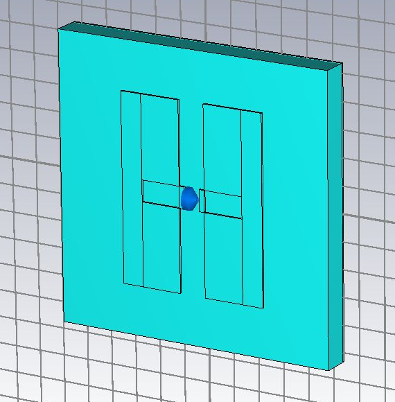

**My unit cell in CST.** The viewport shows the patterned face, dielectric slab and central lumped element. The blue symbol represents an ideal circuit load, not a modeled diode package. This is an actual CST capture, not a reconstructed illustration. The gallery below identifies the different views and layers.

**Current outcome:** my MATLAB correctness checks pass, and I completed 16 CST diagnostic simulations. The current CST cell **does not reproduce the reference paper's reflection states**. I show that mismatch alongside the successful numerical checks. I have not demonstrated measured hardware performance, finite-array full-wave RCS or suppression of structural scattering.

[CST design](#my-cst-design) · [Simulation evidence](#what-i-simulated-and-verified) · [Paper comparison](#the-paper-benchmark-versus-my-results) · [MATLAB results](#what-the-states-do-to-beam-steering) · [Reproduction](#reproduce-the-analysis) · [Deliverables](#reports-data-and-methods)

## Project at a glance

| Item | My implementation / evidence |
|---|---|
| Electromagnetic model | Periodic slotted copper cell, dielectric substrate, grounded baseline, two Floquet modes |
| Operating point | 26.168 GHz; separate coarse diagnostic sweep from 24 to 30 GHz |
| Array study | 400 elements, 5.35 mm pitch, target polar angle 25° / azimuth 15° |
| CST work | 16 completed runs, D003–D018; topology, load, mesh, basis and backing controls |
| MATLAB checks | [15/15 tests pass](results/validated_v2/tests.json); zero-noise identity gives exactly zero difference |
| Strict CST state separation | 0.181° in mode 1; 7.651° in mode 2 |
| Approximate paper separation | 166.347° at the same frequency, from digitized Figure 2 |
| Repository organization | `main` contains the consolidated research work; earlier versions remain in commit history |

My workflow is **CST geometry and boundary conditions → complex ON/OFF coefficients → checked import → MATLAB state assignment → full-hemisphere metrics and plots**. Paper-derived and CST-derived inputs remain separate throughout.

## My CST design

### All six orthogonal views

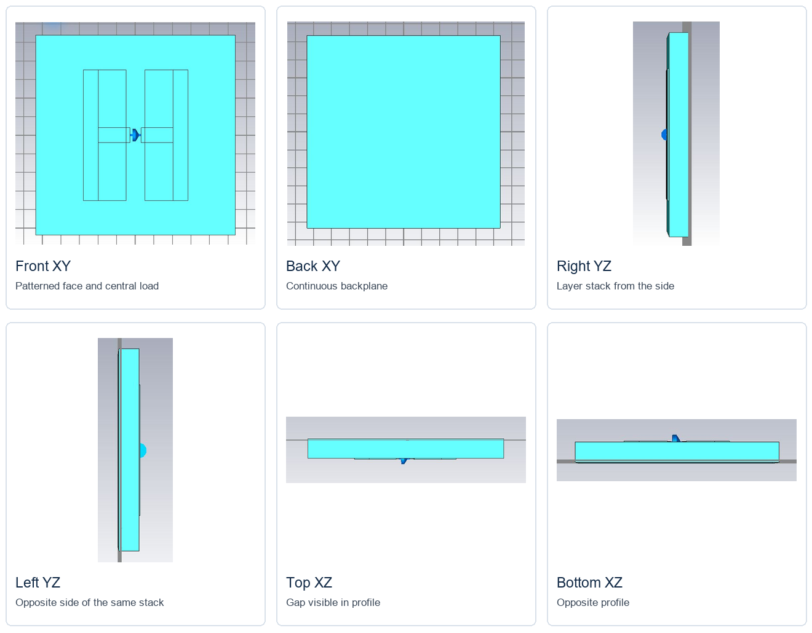

**Front, back and four edge views of the original grounded topology.** Front XY reveals the two slotted patch halves and central gap. Back XY shows the continuous backplane. Right/left YZ and top/bottom XZ show the thin layer stack and load position. These are actual D015/D016 CST captures, arranged on a labeled canvas; **the panels do not share a common scale**. Display colors and outlines alone do not identify material properties. These captures document geometry, not convergence of the associated broadband solve.

Full-size views: [front](figures/cst/front_xy.png), [back](figures/cst/back_xy.png), [right](figures/cst/right_yz.png), [left](figures/cst/left_yz.png), [top](figures/cst/top_xz.png), [bottom](figures/cst/bottom_xz.png). [Capture provenance](figures/cst/capture_provenance.json) records sources, crops and hashes.

### Dimensions and layer stack

I use a square periodic cell. The patch lies in XY; Z is normal to the surface. These dimensions describe my implemented model and retain the source-mapping qualifications in the [physical audit](docs/CST_PHYSICAL_AUDIT.md).

| Feature | Implemented value | Role |
|---|---|---|
| Cell pitch | 5.35 mm in X and Y | Repetition distance of the infinite lattice |
| Pattern extent | 3.5 mm along Y; 2.8 mm combined width along X | Two opposing patterned halves |
| Central gap | 0.3 mm | Space bridged by the lumped element |
| Slot | 2.0 mm along X; 0.4 mm along Y | Shapes the surface-current path |
| Substrate | 0.5 mm; Z = 0 to 0.5 mm | Supports the patterned copper |
| Dielectric approximation | εr = 2.2, μr = 1, tanδ = 0.0009 | Constant RT/duroid 5880 approximation |
| Patterned copper | 35 µm; Z = 0.5 to 0.535 mm | Finite-conductivity metal, σ = 5.8 × 10⁷ S/m |
| Backplane | 35 µm; Z = −0.035 to 0 mm | Continuous reflecting backing in the baseline |
| Lumped endpoints | X = ±0.15 mm, Y = 0, Z = 0.5175 mm | Load connection across the gap |

The original pattern consists of eight top-copper solids: outer strips, upper/lower arms and central lands. Construction history shows **edge/corner-only contact between original lands and arms**, a physical modeling concern. I tested added overlaps and unions separately in D005/D006. Those connected variants are diagnostic assumptions, not an established fabrication reconstruction of the paper. The original high-conductivity bulk-material mesh warnings also remain part of the audit.

### Boundaries, port and solver

| Actual CST boundary dialog | Actual CST Floquet-port dialog |
|---|---|
| 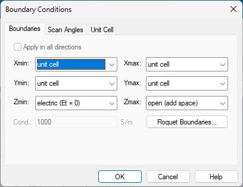 | 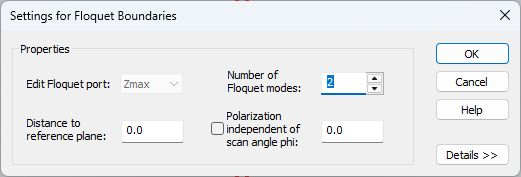 |

**What these settings mean.** Periodic X/Y boundaries represent an infinite repeating sheet. An expanded open Zmax supports illumination from above. The grounded baseline uses an electric Zmin together with the copper backplane. I retain two fundamental Floquet modes at normal incidence, θ = φ = 0, with reference-plane distance zero. A verified 0°/90° basis swap does not yet establish their global Cartesian field directions.

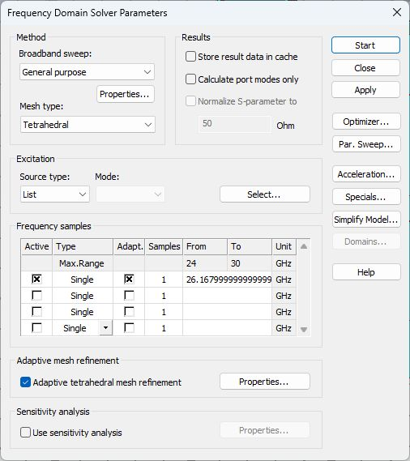

**My frequency-domain setup.** I use the general-purpose tetrahedral solver. Strict D009/D010 adaptation at directly solved 26.168 GHz required two consecutive all-S changes below 0.005, with a maximum of 12 passes. A global range of 24–30 GHz does not mean every frequency was directly solved. This screenshot documents settings; the exported adaptive history establishes the stopping evidence.

### How I represent switching

| State | Series equivalent used | Interpretation |
|---|---|---|
| ON | R = 5.2 Ω, L = 30 pH, C = 0 | Lossy inductive proxy |
| OFF | R = 0, L = 30 pH, C = 25 fF | Capacitive proxy with assumed zero resistance |
| Approximate short | R = 0.001 Ω, L = C = 0 | Tests whether the gap load affects the cell |
| Approximate open | R = 10⁹ Ω, L = C = 0 | Contrasting load-sensitivity control |

These are provisional linear models, not diode calibrations at 26.168 GHz. The historical element name can still read `PIN_ON_series_RL` in an OFF project: I identify the state from the final literal R/L/C modification in history, not its label or potentially stale parameters. Manufacturer fixture, bias, variant equivalence and de-embedding remain unresolved. [Manufacturer applicability](docs/CST_PHYSICAL_AUDIT.md#manufacturer-model-applicability)

## What I simulated and verified

| Runs | Controlled question | What I learned |
|---|---|---|
| D003/D004 | Original topology, short versus open | Mode 2 responds more strongly to the load |
| D005/D006 | Connected topology, short versus open | Added overlaps alone do not recover the published contrast |
| D007/D008 | Adaptive ON/OFF investigation | Initial coefficients depend on refinement |
| D009/D010 | Strict ON/OFF at 26.168 GHz | Both meet the consecutive all-S stopping criterion |
| D011–D014 | Fixed 0°/90° port bases | Modal swap agrees below 9 × 10⁻⁹ in complex coefficient |
| D015/D016 | Eight directly solved broadband frequencies | Coarse frequency diagnostic; no broadband convergence claim |
| D017/D018 | Remove backplane and add a bottom port | Backing changes mode 2, including substantial transmission |

Preparation failures D000–D002 are excluded from the 16 completed simulations. [Simulation summary](results/cst_diagnostics/simulation_summary.csv) · [Run provenance](results/cst_diagnostics/manifest.json)

### Load sensitivity

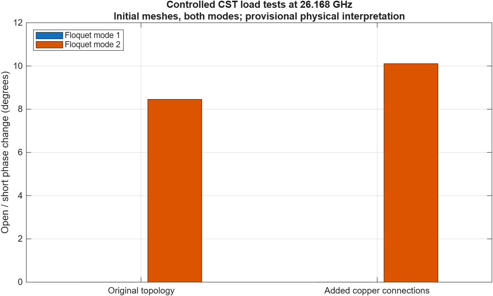

**Actual CST results at 26.168 GHz.** Within each topology, only the approximate short/open load changes. The original cell gives phase changes of **0.001509° / 8.456462°** for modes 1/2. The connected variant gives **0.002820° / 10.107570°**. These initial-mesh controls reveal load sensitivity; they do not establish mesh independence or a complete cause for the paper mismatch.

### Adaptive mesh evidence

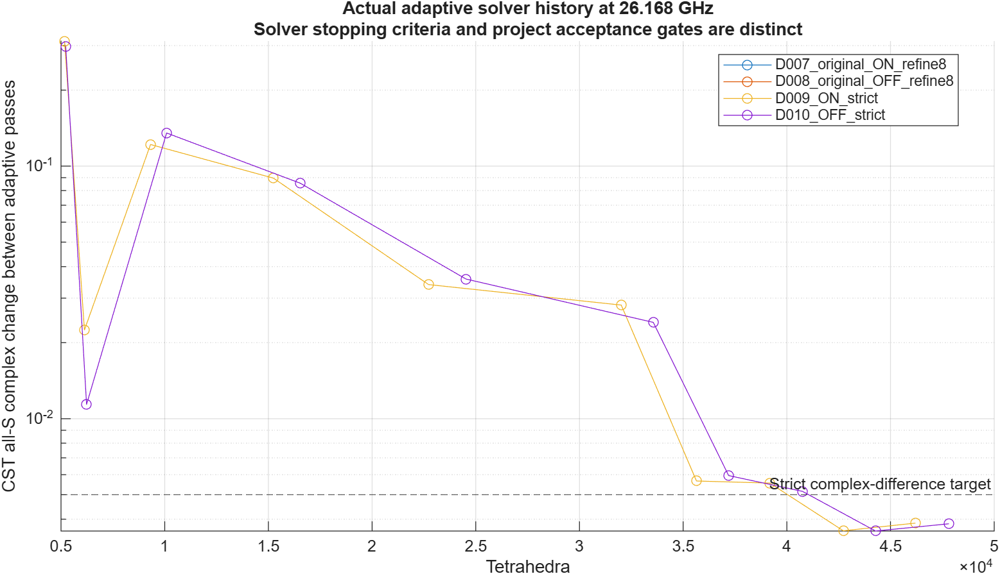

**Mesh convergence at one frequency.** D009/D010 each reached 11 passes: 46,198 tetrahedra ON and 47,811 OFF. Last two all-S changes were 0.003598/0.003859 and 0.003590/0.003836 respectively, below 0.005. Derived local bounds are below 0.005 in magnitude and 0.224° in phase. These are bounds from all-S changes, not individually saved per-pass coefficient traces. Numerical stability at one frequency does not validate physical geometry or broadband response.

[Adaptive history](results/cst_diagnostics/adaptive_mesh_history.csv) · [Strict bounds](results/cst_diagnostics/strict_convergence_bounds.csv)

### Numerical consistency

I checked complex coefficients, modal powers and lumped voltage/current. The completed exports pass the modal passivity screen of ≤1.001. Independently summed reflected **and transmitted** modes, with reported material/lumped losses, give a maximum relative balance residual below **7.3 × 10⁻⁷**; the V − ZI residual is below **3 × 10⁻¹⁶**.

For two-sided D017/D018, the native curve `Power Outgoing all Ports` omits bottom-port power in these exports. I preserve that raw curve separately and calculate the balance using both ports. Transmission is not absorption. A grounded value of 1 − reflectance alone is not an independent loss validation.

## The paper benchmark versus my results

My reference is Goshu et al., *Realistic Evaluation of Impedance-Based RIS Modeling: Practical Insights and Applications*, EuCAP 2025 ([author manuscript](https://arxiv.org/abs/2508.07098)). The paper studies impedance-based optimization and full-wave array RCS, including structural scattering.

I intended to recover a large ON/OFF phase contrast while retaining useful reflection magnitude, then use those hardware states to steer an array. The table shows where my model stands against that first objective.

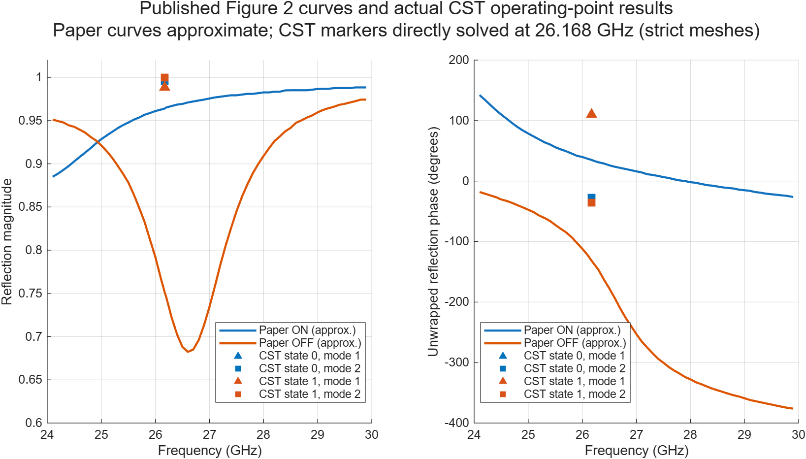

**Reference versus simulation.** Paper curves are approximate raster digitizations of supplied Figure 2, not output from my CST model. The digitizer records PDF hash, calibration, exclusions and phase unwrapping. Estimated reading resolution is about 0.004 in magnitude, 2° in phase and 0.02 GHz, with additional unknown registration error; these are not confidence intervals.

| Dataset at 26.168 GHz | ON magnitude / phase | OFF magnitude / phase | Shortest state separation |
|---|---:|---:|---:|
| Approximate paper Figure 2 | 0.96383 / 35.07° | 0.75205 / −131.28° | **166.347°** |
| My strict CST, mode 1 | 0.98823 / 110.19° | 0.98821 / 110.37° | **0.181°** |
| My strict CST, mode 2 | 0.99602 / −27.86° | 0.99982 / −35.51° | **7.651°** |

**Interpretation:** my strict cell is highly reflective, but switching barely changes phase in mode 1 and gives only a small contrast in mode 2. Neither reproduces the paper. Absolute phase requires matched reference planes; I have not fitted an offset to imply agreement. The [comparison CSV](results/cst_diagnostics/paper_matched_frequency_comparison.csv) retains complex errors.

### Broadband and backing checks

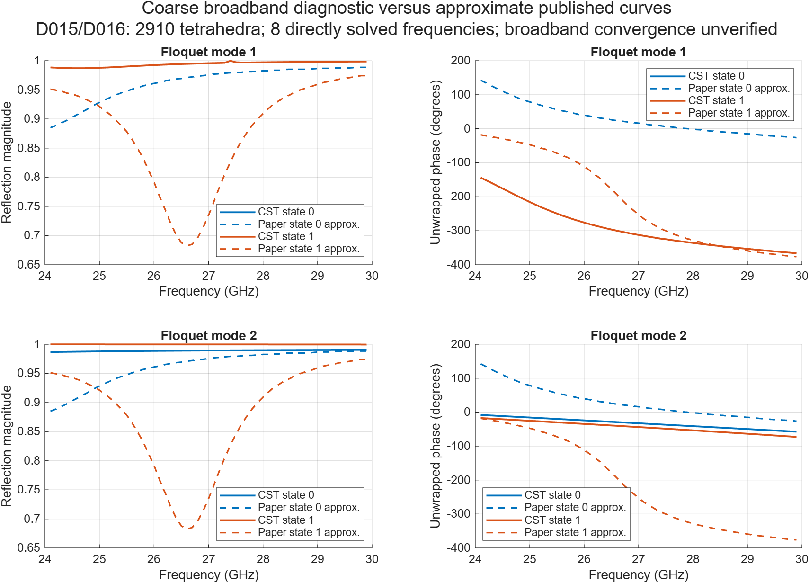

**Coarse broadband diagnostic, D015/D016.** Direct frequencies are 24, 25, 26, 26.168, 27, 28, 29 and 30 GHz; the 1,006 exported samples include interpolation. Copying the strict project with results did not retain its refined mesh in the new solve: both logs report 2,910 tetrahedra. These curves do not establish resolved resonances or broadband convergence. The strict operating-point evidence remains separate.

Removing the backplane, opening the bottom boundary and adding a bottom Floquet port produced **88.70°** mode-2 separation, but only **0.1153 ON / 0.3882 OFF** reflection magnitude. Transmitted power fractions were **0.8895 / 0.8486**. Mode-1 separation remained about 0.00049°. This initial-mesh counterfactual shows backing sensitivity; it does not reproduce the paper. [Backing-test data](results/cst_diagnostics/ungrounded_comparison.csv)

## What the states do to beam steering

### MATLAB model and conventions

I place 400 elements in XY under normal incidence. **θ is polar angle from +Z; φ is azimuth from +X toward +Y.** The requested beam is θ = 25°, φ = 15° at 26.168 GHz. Every configuration is a 400 × 1 complex column.

```text
AF(s) = sum_m Γ_m exp[j k r_m · (s − s_inc)]
Γ_continuous,m = exp[−j k r_m · (s_target − s_inc)]
Common power reference = |AF|² / 400²
```

I compare continuous phase, ideal binary phase, digitized paper states and actual CST states. The hemisphere grid is θ = 0:1:90°, φ = −180:1:179°, followed by local refinement of multiple candidates and the target. This sampled search is not proof of a global optimum. I report exact target power, refined peak and spherical pointing error separately. Solid-angle integrals include sin(θ).

These normalized scalar array-factor results are **not dBi, efficiency, measured gain or RCS**. They omit finite-array electromagnetic interactions and structural scattering. A maximum outside the 15° target cone can be another main beam, so I do not automatically call it a sidelobe.

### Intended steering with paper-derived states

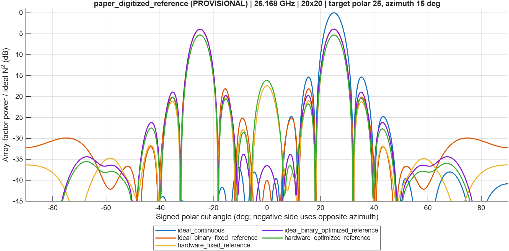

**20 × 20 array, target 25°/15°.** All curves share the ideal continuous coherent reference. Negative signed angle follows the opposite azimuth. The paper-derived binary states steer toward the target but retain a nearly equal mirror beam.

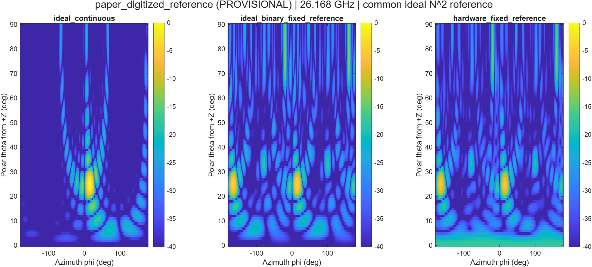

**Why I inspect the hemisphere.** A single cut or small pointing error can conceal another beam. This map provides angular context using the common reference. It is my MATLAB calculation with digitized inputs, not the paper's full-wave RCS result.

| Input / assignment | Target power (dB) | Refined peak (dB) | Pointing error |
|---|---:|---:|---:|
| Ideal continuous | 0.000 | 0.000 | 0.000° |
| Ideal binary, fixed reference | −3.930 | −3.925 | 0.120° |
| Paper-derived states, fixed | −5.313 | −5.312 | 0.026° |
| Paper-derived states, optimized reference | −5.302 | −5.300 | 0.073° |
| My strict CST mode 1, fixed | −58.727 | −0.103 | 25.000° |
| My strict CST mode 2, fixed | −27.273 | −0.037 | 25.000° |

Reference optimization gives a small target-power improvement for the paper-derived states. It does not remove the mirror beam. [Full-precision metrics](results/validated_v2/paper_digitized_reference/array_factor_metrics.csv)

### My actual strict CST coefficients in MATLAB

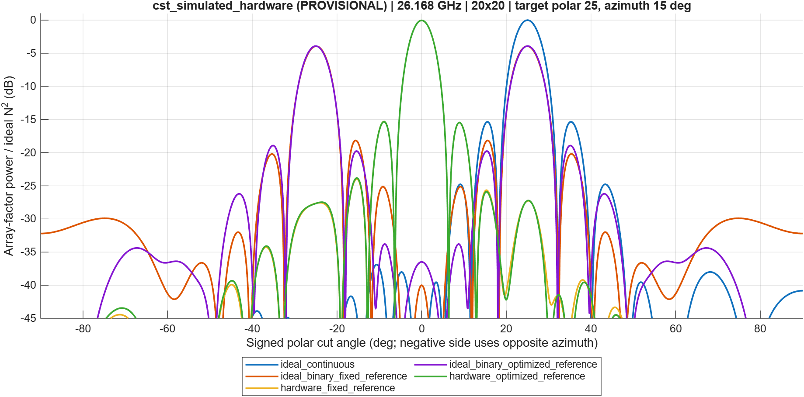

**Strict CST mode 2 → MATLAB, same array and reference.** The strongest beam stays near broadside, about 25° from the requested direction. The two available states are too similar to implement the required phase profile. Mode 1 is less responsive. This functioning pipeline exposes a hardware-model mismatch; it does not demonstrate successful hardware steering. [Mode-1 results](results/validated_v2/cst_strict_mode1_provisional) · [Mode-2 results](results/validated_v2/cst_strict_mode2_provisional)

### Correctness and uncertainty

- All 15 tests pass, including coefficient shape, steering sign, broadside degeneracy, binary limits, mirror detection, complex interpolation and regressions.
- A fresh original MATLAB run did not exhibit the suspected 400 × 400 expansion. Explicit reshaping and assertions enforce the column without relying on vector-indexing behavior.
- The shared deterministic/uncertainty evaluator gives exactly zero metric difference at zero noise. The historical generator used a different angular grid.
- Uncertainty scenarios use 40 trials per setting, seed 20261022, independent normal phase errors and clipped multiplicative amplitude errors. These are assumed perturbations, not measured fabrication statistics. CSVs include standard error, approximate mean intervals and empirical percentiles.
- Under the same channel definitions, Eq. (1), `hᴴΦg`, is aligned by `arg(h) − arg(g) + α`. The opposite sign printed in Eq. (6) gives magnitude 8.05174 versus 400 in my direct check. This documents a convention inconsistency without claiming the authors implemented that rule incorrectly.

## My impedance-model extension

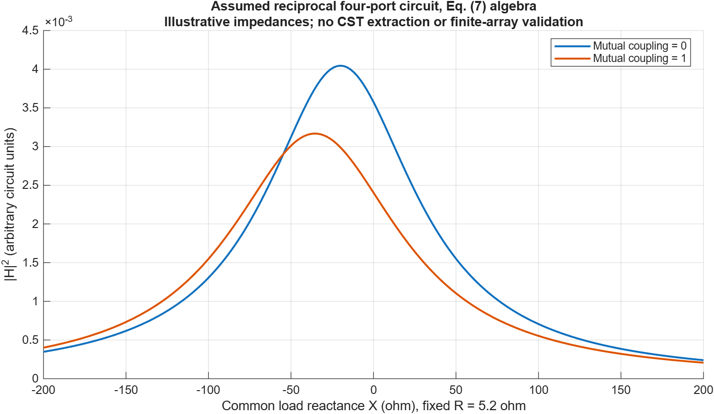

**Illustrative circuit, not CST-extracted coupling.** I use an assumed reciprocal passive four-port matrix: self impedance 50 + j20 Ω, adjacent mutual impedance 5 + j12 Ω. I compare diagonal and coupled assumptions while sweeping common reactance −200 to 200 Ω at R = 5.2 Ω. Arbitrary output units do not quantify this device's scattering.

I solve `H = −z_RS (Z_SS + Z_load)^−1 z_ST`, with `y0 = 1`, `Z_RT = 0`, and check reciprocity, positive-definite real impedance and residual identities. The matched-load term can remain nonzero even at zero load reflection, illustrating Eq. (11). This does not reproduce the paper's optimized full-wave result. Binary quantization lobes and structural scattering are different effects.

## How my work relates to the paper

| Question | Reference study | My contribution / current boundary |
|---|---|---|
| Realistic states | Published unit-cell magnitude and phase | Traceable digitization, strict CST comparison and explicit failed benchmark |
| Beam control | Conventional/impedance optimization and full-wave array RCS | Reproducible independent-element comparison with one common reference |
| Competing lobes | Scattering and optimization context | Hemisphere search, separate target/peak metrics and mirror-beam checks |
| Hardware sensitivity | Physical RIS model | Load, connectivity, basis, mesh and backing controls |
| Coupling / structural term | Impedance formulation and full-wave assessment | Checked assumed four-port example; device-specific extraction remains open |

My extension is the reproducible diagnostic and evaluation workflow. I do not claim improved experimental performance or reproduction of the paper's full-wave results.

## Reproduce the analysis

In licensed MATLAB, change the current folder to the repository root and run:

```matlab
addpath(fullfile(pwd, 'matlab'));
run_research();
```

This runs the correctness gate, then regenerates analytical outputs under `results/validated_v2`. My documented replay used MATLAB R2026b on Windows. The importer interpolates real/imaginary coefficients, rejects extrapolation and records state, mode, frequency, source hashes and status. The checked-in digitization supports analytical replay; the licensed PDF is not redistributed. Hashing currently uses Windows .NET.

For CST, use its installed 2023 Python runtime and a licensed session. The workflow starts from the preserved baseline, attaches to the selected process, writes a checkpoint, exports complex results and analyzes the run. **Use a new experiment ID** each time:

```text
<CST-Python> cst/native_diagnostic.py <NEW_ID> --pid <CST_PID> --R 0.001
<CST-Python> cst/export_diagnostic.py cst/experiments/<NEW_ID>
python tools/analyze_diagnostics.py
```

`--topology connected` selects the documented overlap diagnostic. `--adaptive --strict-adaptive` requests the consecutive all-S criterion. Inspect final literal load values before solving. The [physical audit](docs/CST_PHYSICAL_AUDIT.md), [methods](docs/SCIENTIFIC_VALIDATION.md) and run configurations explain assumptions and exports. Digitization additionally requires NumPy, pandas, Pillow and Poppler.

Construction histories, configurations, numerical exports and redacted solver logs are public. New native checkpoints remain local because the archives embed licensing metadata. Recordings are excluded. Public provenance identifies the simulated inputs without redistributing private machine diagnostics.

## Reports, data and methods

| Resource | Contents |
|---|---|
| [Technical report](output/pdf/RIS_Scientific_Validation_Report.pdf) | Scientific validation and conclusions |
| [Research presentation](output/presentation/RIS_Scientific_Validation_v2.pptx) | Presentation of the study and evidence |
| [Verification status](docs/VERIFICATION_STATUS.md) | Passed, provisional and failed gates |
| [Physical audit](docs/CST_PHYSICAL_AUDIT.md) | Geometry, load, material, boundary and manufacturer assumptions |
| [Scientific methods](docs/SCIENTIFIC_VALIDATION.md) | Equations, coordinates, normalization and metrics |
| [Assumption ledger](docs/ASSUMPTIONS.md) | Boundaries on interpretation |
| [CST data](results/cst_diagnostics) | Run summaries, mesh history and comparison CSVs |
| [MATLAB outputs](results/validated_v2) | Figures, metrics, tests and provenance |
| [Repair log](docs/audit/repair_log.md) / [file index](docs/FILE_INDEX.md) | Decisions and exact public change hashes |

### Remaining physical-validation gates

I still need global Cartesian mode fields, resolved source geometry/contact and backing interpretation, calibrated diode behavior at the operating frequency, material checks, saved-refinement coefficient comparisons and converged resonance/broadband sampling. Device-specific impedance extraction and finite-array full-wave or measured validation are subsequent stages. These open gates qualify the hardware conclusions even though the computational audit and analytical reproduction workflow are complete.
