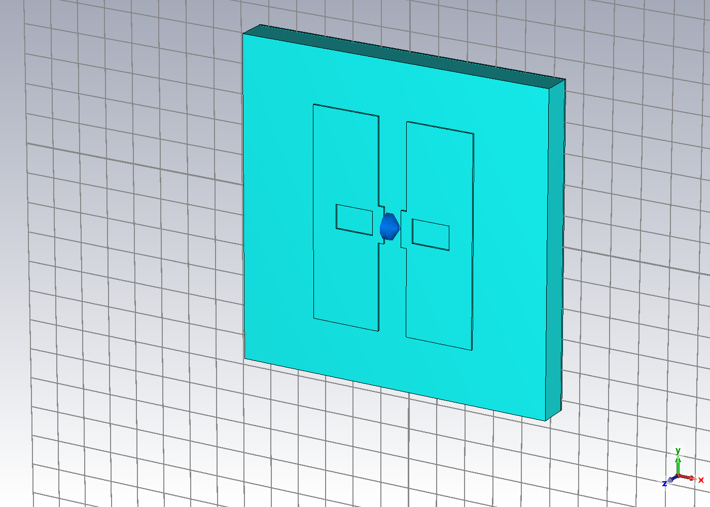
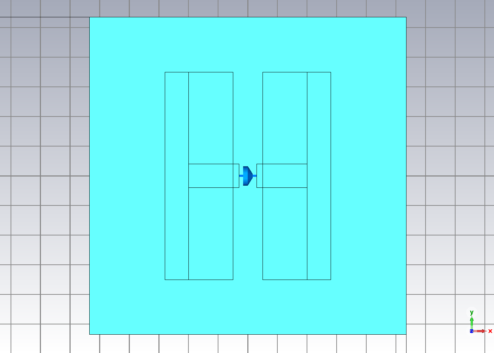
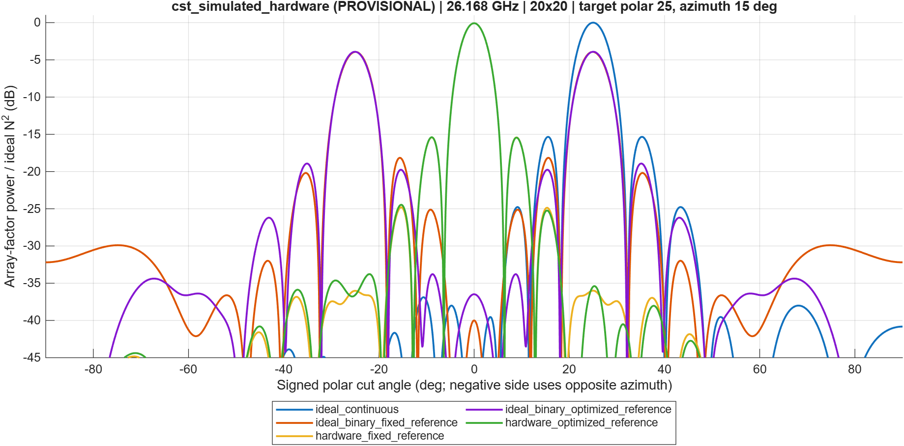

# Hardware-aware RIS beam steering

### Scientific validation, CST unit-cell diagnostics and reproducible MATLAB analysis

I investigate how a limited set of complex reflection states changes predicted RIS beam steering. I connect actual CST 2023 unit-cell evidence to a tested 20 × 20 independent-element array model and an explicitly illustrative impedance-circuit extension.

**Research status:** the analytical correctness gate passes. The current CST model has not established reproduction of the reference paper. Failed benchmarks and unresolved physical assumptions remain visible. No physical measurements or validated finite-array RCS are claimed.

| Evidence gate | Status | Evidence |
|---|---|---|
| MATLAB correctness | **PASS** | [15 automated tests](results/validated_v2/tests.json) |
| Zero-perturbation identity | **PASS** | Exactly zero metric difference from the deterministic evaluator |
| Actual CST diagnostics | **PASS execution** | [Controlled load tests](results/cst_diagnostics/open_short_comparison.csv) |
| Export checks | **PASS numerical screens** | [Power balance, passivity and V/I](results/cst_diagnostics/manifest.json) |
| Mesh investigation | **PROVISIONAL physical acceptance** | [Actual adaptive history](results/cst_diagnostics/adaptive_mesh_history.csv) |
| Paper Figure 2 reproduction | **FAIL current benchmark** | [Matched-frequency comparison](results/cst_diagnostics/paper_matched_frequency_comparison.csv) |
| Exact diode and polarization | **PROVISIONAL** | [Physical audit](docs/CST_PHYSICAL_AUDIT.md) |
| Impedance extension | **PASS algebra / assumed scenario** | [Four-port analysis](results/validated_v2/illustrative_impedance_example/manifest.json) |

Work proceeds on `research/validation-and-cst-repair`. Historical work is preserved at main commit `4d61322`. No unvalidated findings are promoted to main.

## What I built in CST



**Figure 1. Actual CST viewport, connected diagnostic topology.** Two slotted copper patches sit on a 0.5-mm RT/duroid 5880 substrate, with a central lumped load and a continuous backplane. Added overlap pads test connectivity and remain fabrication assumptions. This native export is distinct from the historical redrawn three-view schematic. Its side view omitted the ground and is superseded.

| Feature | Implemented value | Interpretation / limitation |
|---|---|---|
| GL / periodic pitch | 5.35 mm | Infinite square lattice |
| PL / PW | 3.5 / 2.8 mm | Y extent / combined X extent; source mapping provisional |
| GW / SW / SL | 0.3 / 2.0 / 0.4 mm | Gap / slot length / slot width |
| Substrate | 0.5 mm, εr = 2.2, tanδ = 0.0009 | Constant material approximation |
| Copper | 35 μm, 5.8×10⁷ S/m | Thickness assumption; legacy bulk-material warning |
| Ground | Continuous copper + electric Zmin | Source interpretation unresolved |
| Boundaries | Periodic X/Y, expanded open Zmax | No finite-array edge validation |
| Excitation | Two fundamental Floquet modes, normal incidence | Physical polarization requires verification |
| ON proxy | Series 5.2 Ω + 30 pH | Not calibrated at the operating frequency |
| OFF proxy | Series 30 pH + 25 fF, R = 0 | Assumed capacitance and loss model |

The [source-to-model audit](docs/CST_PHYSICAL_AUDIT.md) records unresolved mappings. Construction history places the original diode lands and patch arms in edge-only contact. This motivated controlled tests before any tuning.



**Original-topology XY view at the copper midplane.** This native CST view exposes the separate outer patches, arms and diode lands. It differs from the connected diagnostic perspective above. Orthogonal side-section framing remains a display limitation, so cropped exports are excluded from the presentation.

## Actual load and mesh diagnostics


**Figure 2. Actual CST load tests at 26.168 GHz.** Within each topology, only the load changes: approximate short 0.001 Ω versus approximate open 10⁹ Ω, L = C = 0. Initial meshes support a diagnostic comparison, not mesh independence.

| Topology | Mode 1 phase change | Mode 2 phase change |
|---|---:|---:|
| Original | 0.001509° | 8.456462° |
| Added connections | 0.002820° | 10.107570° |

The load couples much more strongly to mode 2. Added copper connections alone do not recover the large published state separation. I have not established one complete causal explanation for the failed reproduction.

The completed exports pass the two-mode reflected-power screen of ≤1.001. Power balances agree to better than 7.3×10⁻⁷ relative residual, and V − ZI to below 3×10⁻¹⁶. [Per-run evidence](results/cst_diagnostics/simulation_summary.csv) includes complex coefficients, current, voltage, losses and mesh records.


**Figure 3. Actual adaptive history at directly solved 26.168 GHz.** The initial adaptive ON run progressed from 2,910 to 35,643 tetrahedra. The strict ON run reached 46,198 tetrahedra with two consecutive all-S changes below 0.005. Solver stopping and complete physical acceptance remain distinct. Single-frequency results do not establish broadband convergence.

After strict refinement, mode-1 phases are 110.19° ON and 110.37° OFF, a separation of about **0.18°**. The old 2.87° contrast was not stable under refinement. Mode 2 gives about 7.65° separation. Neither pair approaches the published separation.

## Published benchmark versus my CST results

Reference: Goshu et al., *Realistic Evaluation of Impedance-Based RIS Modeling: Practical Insights and Applications*, EuCAP 2025 ([author manuscript](https://arxiv.org/abs/2508.07098)). The paper compares conventional and impedance-based optimization with full-wave array RCS and discusses structural scattering.


**Figure 4. Approximate digitization of the supplied Figure 2.** The generator records PDF hash, pixel calibration, legend exclusions and phase unwrapping. Estimated raster reading resolution is about 0.004 magnitude and 2° phase, with additional unknown plotting and registration error. These curves were not calculated by my CST model.

| At 26.168 GHz | ON magnitude / phase | OFF magnitude / phase |
|---|---|---|
| Approximate paper digitization | 0.96383 / 35.07° | 0.75205 / −131.28° |
| Strict adaptive CST, mode 1 | 0.98823 / 110.19° | 0.98821 / 110.37° |
| Strict adaptive CST, mode 2 | 0.99602 / −27.86° | 0.99982 / −35.51° |

Absolute phase comparison also requires matched reference planes. The [comparison CSV](results/cst_diagnostics/paper_matched_frequency_comparison.csv) retains complex errors and wrapped phase errors without fitting an offset. Matching one point would still not prove broadband reproduction.

MACOM's linked S2P data cover 2–50 GHz but use MA4AGP907 filenames and wafer/PCM metadata. Exact variant equivalence, bias and de-embedding to the CST gap remain unresolved. The SPICE presentation includes a fixture and nonlinear model. I do not treat these as a calibrated lumped junction. See [manufacturer applicability](docs/CST_PHYSICAL_AUDIT.md#manufacturer-model-applicability).

## Repaired MATLAB analysis

The array lies in XY. **θ is polar angle from +Z**, and φ is azimuth from +X toward +Y. At broadside, φ = 0. Every configuration has 400 complex coefficients in a column.

```text
AF(s) = sum_m Γ_m exp[j k r_m · (s − s_inc)]
Γ_continuous,m = exp[−j k r_m · (s_target − s_inc)]
```

Every main pattern uses `|AF|² / 400²`. These are scalar array-factor power ratios, not dBi, realized gain, efficiency or RCS. I separate exact target power, sampled/refined peak power, spherical pointing error and the maximum outside a 15° target cone. That maximum can include a competing main beam. Solid-angle integration uses `sin(θ) dθ dφ`.


**Figure 5. Approximate paper states, 20×20, pitch 5.35 mm, 26.168 GHz, target polar 25° / azimuth 15°.** Negative signed angle uses the opposite azimuth. Every curve shares the ideal continuous coherent reference. The competing mirror beam remains nearly equal to the requested beam.

| Input / control | Target (dB) | Refined peak (dB) | Pointing error |
|---|---:|---:|---:|
| Ideal continuous | 0.000 | 0.000 | 0.000° |
| Ideal binary, fixed reference | −3.930 | −3.925 | 0.120° |
| Digitized paper states, fixed | −5.313 | −5.312 | 0.026° |
| Digitized paper states, optimized | −5.302 | −5.300 | 0.073° |
| Historical CST states, fixed | −35.999 | −0.077 | 25.000° |
| Strict CST mode 1, fixed | −58.727 | −0.103 | 25.000° |
| Strict CST mode 2, fixed | −27.273 | −0.037 | 25.000° |

A small pointing error alone does not establish a clean single beam. Reference optimization marginally improves target power while retaining the competing lobe.



**Figure 6. Actual historical CST coefficient input, same array and normalization.** The strongest response remains near broadside. This separately labeled provisional result prevents paper coefficients from concealing a failed hardware model. Newly refined coefficients require the physical acceptance gates before supporting stronger hardware claims.

### Correctness evidence

- All 15 tests pass, including complex coefficient shapes, steering, broadside degeneracy, binary limits, full-hemisphere mirror detection, complex interpolation, zero frequency offset and regressions.
- A fresh original MATLAB run produced a column. The suspected 400×400 expansion was not observed. Explicit reshaping and assertions remove reliance on MATLAB's vector indexing rule.
- The historical uncertainty CSV came from a separate generator with a different angular grid. The repaired shared evaluator gives **exactly zero** difference at zero noise.
- Forty trials per setting use seed 20261022. Independent normal phase and clipped multiplicative amplitude errors are assumed scenarios, not measured fabrication statistics. CSVs include standard errors, approximate mean intervals and empirical percentiles.
- Eq. (1), `hᴴΦg`, aligns with `φ = arg(h) − arg(g) + α`. Under the same channel definitions, the printed Eq. (6) has the opposite sign. Direct multiplication gives magnitudes 400 versus 8.05174. This identifies an algebraic convention inconsistency without claiming the authors implemented the wrong rule.

[Methods and metric definitions](docs/SCIENTIFIC_VALIDATION.md)

## Impedance-model extension


**Figure 7. Assumed reciprocal passive four-port circuit using Eq. (7).** Self impedance is 50+j20 Ω and adjacent mutual impedance 5+j12 Ω. The calculation compares diagonal and coupled assumptions while sweeping a common reactance. Its arbitrary units do not quantify this device's scattering.

The extension solves `H = −z_RS (Z_SS + Z_load)^−1 z_ST` with `y0=1`, `Z_RT=0`. The matched-load term can remain nonzero at zero load reflection coefficient, illustrating Eq. (11). Reciprocity, positive-definite real impedance and direct residual identities are checked. This does not reproduce the paper's impedance optimization. Binary quantization lobes remain distinct from structural scattering.

## Reproduction

From the repository root in licensed MATLAB R2026b on Windows:

```matlab
addpath(fullfile(pwd, 'matlab'));
run_research();
```

The correctness gate runs first, then regenerates analytical results under `results/validated_v2`. The digitized input is checked in. The original licensed PDF is not redistributed.

```text
python tools/digitize_figure2.py --pdf <local-paper.pdf> --pdftoppm <Poppler-executable>
<CST-Python> cst/native_diagnostic.py <NEW_ID> --pid <CST_PID> --R 0.001
<CST-Python> cst/export_diagnostic.py cst/experiments/<NEW_ID>
python tools/analyze_diagnostics.py
```

Use CST 2023's installed Python 3.6 runtime and a licensed session. Every experiment needs a new ID. `--topology connected` adds the documented overlaps. `--adaptive --strict-adaptive` requests two all-S changes below 0.005. The final history block's literal load values are authoritative; legacy parameter names remain preserved.

Construction histories, configurations, transparent numerical exports and redacted solver logs accompany completed runs publicly. New native CST checkpoints and expanded results remain preserved locally because the native archives embed licensing metadata. They are excluded from this public branch. The automation starts from the preserved baseline project and writes new local checkpoints. Manifests identify source hashes and generators. MATLAB hashing currently uses Windows .NET. Digitization uses NumPy, pandas, Pillow and Poppler. The converter rejects extrapolation and interpolates real/imaginary coefficients with explicit state, mode, source checkpoint and status.

## Deliverables and boundaries

- [Technical report](output/pdf/RIS_Scientific_Validation_Report.pdf)
- [Professor-facing presentation](output/presentation/RIS_Scientific_Validation_v2.pptx)
- [Verification status and actual simulations](docs/VERIFICATION_STATUS.md)
- [Scientific methods](docs/SCIENTIFIC_VALIDATION.md)
- [Physical audit](docs/CST_PHYSICAL_AUDIT.md)
- [Repair log](docs/audit/repair_log.md) and [baseline inventory](docs/audit/baseline_inventory.json)
- [Simulation summary](results/cst_diagnostics/simulation_summary.csv)
- [Analytical results and provenance](results/validated_v2)

Remaining gates include Cartesian mode-field verification, saved-refinement coefficient comparisons, material treatment, resonant sampling, exact diode applicability and source geometry. No finite-array full-wave or measured hardware validation is claimed. Recordings stay outside the public repository.

**Defensible CV wording:** Developed and tested a reproducible MATLAB study of nonideal binary RIS states; performed CST 2023 periodic unit-cell load diagnostics, complex S-parameter export and mesh-refinement investigations with traceable assumptions and numerical evidence.

## Additional diagnostics, 23 October 2026

I completed **16 new CST simulations, D003-D018**, preserving each checkpoint,
configuration, native complex exports and solver log. Preparation failures D000-D002
are excluded from that count.


**Broadband diagnostic, D015/D016.** Solid curves show actual CST output; dashed
curves show approximate paper digitization. Both Floquet modes use consistent
magnitude and unwrapped phase axes. Direct frequencies are 24, 25, 26, 26.168, 27,
28, 29 and 30 GHz. The 1,006 exported points include interpolation. Copying the
strict project with results did **not** retain its refined mesh in the new solve:
the logs report 2,910 tetrahedra. These curves therefore do not establish broadband
convergence or resolved resonances. The strict operating-point evidence above
remains a separate dataset.

**Ground-removal test, D017/D018.** I removed the copper backplane, changed the
bottom boundary to expanded open and added a bottom Floquet port. This is a
counterfactual backing test, not an established reconstruction of the paper.
Mode 1 changes by about 0.00049 degrees between states. Mode 2 changes by about
88.70 degrees, but its reflection magnitudes are only 0.1153 ON and 0.3882 OFF,
with transmitted fractions 0.8895 and 0.8486. The backing affects the response
substantially; removing it does not recover the paper benchmark. Initial meshes
make this a diagnostic observation, not a converged physical conclusion.

For these two-sided cells I sum both reflected and both transmitted modes.
The native curve labeled `Power Outgoing all Ports` omits bottom-port power in
these exports; its raw values and residuals remain in the evidence table.
The independently summed modal balance, including reported material and lumped
losses, has maximum relative residual below 7.3e-7 across all completed runs.
Transmission is never counted as absorption.

See [ground-test numbers](results/cst_diagnostics/ungrounded_comparison.csv),
[verification and next gates](docs/VERIFICATION_STATUS.md),
[assumption ledger](docs/ASSUMPTIONS.md) and [exact change index](docs/FILE_INDEX.md).
