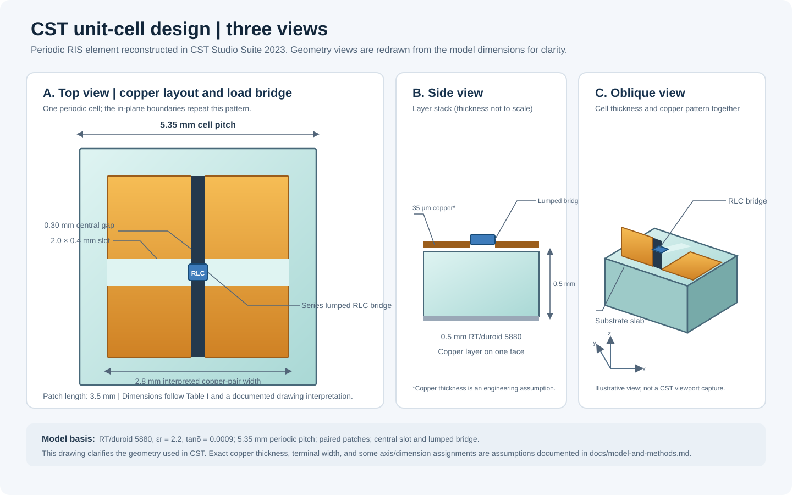
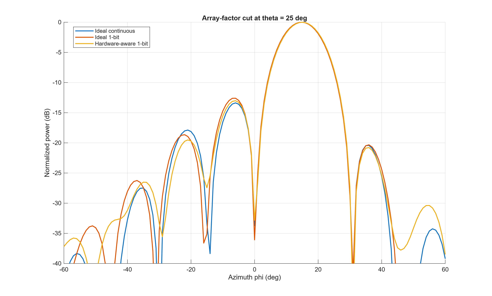
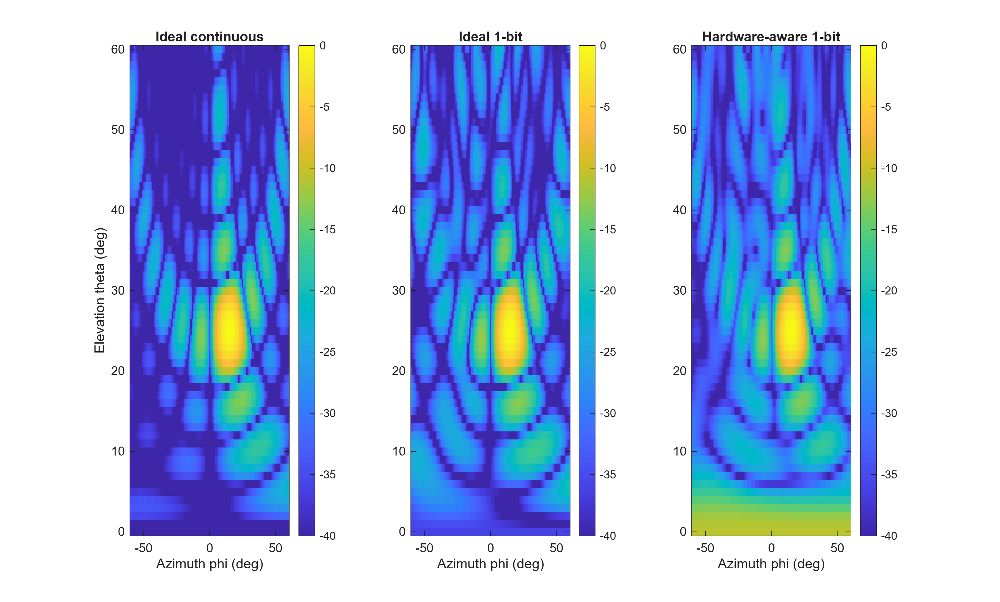

# Hardware-Aware RIS Beam Steering

I built a CST Studio Suite 2023 periodic RIS unit-cell model and a separate MATLAB 20 × 20 array-factor study, guided by Goshu et al.'s 2025 paper on realistic impedance-based RIS modeling.

**The design dimensions and frequency sweep are paper-guided, but this is not a full reproduction of the paper's reflection states or array RCS.** My CST load cases produce almost identical reflection coefficients near the paper's 26.168 GHz operating point. The MATLAB hardware-aware case instead uses approximate reflection coefficients digitized from the paper's Fig. 2. I keep these two evidence paths separate below.

## Project at a glance

| Work | What I implemented | Evidence and status |
|---|---|---|
| Periodic CST cell | Paired copper patches, central gap and slot, RT/duroid 5880 substrate, lumped series RLC bridge, periodic boundaries, two Floquet modes | Three CST projects and complex S-parameter exports; geometry is a documented interpretation of the paper drawing |
| CST frequency study | 24–30 GHz frequency-domain sweep with normal-incidence Floquet excitation | OFF-scenario run: 8 calculated adaptive samples and 1,001 interpolated points; 4,682 tetrahedra |
| MATLAB array study | Independent-element 20 × 20 array; ideal continuous, ideal one-bit, and paper-state hardware-aware controls | Normalized array-factor figures and metrics; not full-wave RCS |
| Extension | Target-angle, state phase-separation, frequency-slope, and random amplitude/phase sensitivity sweeps | CSV outputs; some sweeps use assumed inputs and are exploratory |

## CST unit-cell design



**Figure 1 — My CST cell, shown from three directions.** The top view identifies the two copper regions, central gap, horizontal slot, and RLC bridge. The side view shows the substrate and one-sided copper pattern. The oblique view helps relate the layout to the finite-thickness substrate. This clean diagram is redrawn from my CST model parameters; it is not a CST screenshot. Layer thickness is not drawn to scale.

### Geometry and materials

| Parameter | Paper value or description | CST model used here |
|---|---|---|
| Lattice pitch | 5.35 mm | 5.35 mm square periodic cell |
| Substrate | Rogers RT/duroid 5880; εr = 2.2; tanδ = 0.0009; 0.5 mm thick | Same nominal values |
| Copper pattern | Two patches, a separating gap and a horizontal slot | Two patch regions; PL = 3.5 mm, interpreted combined width PW = 2.8 mm, GW = 0.3 mm, slot SW × SL = 2.0 × 0.4 mm |
| Copper and terminal details | Not fully specified in the paper | 35 µm copper and 0.1 mm terminal width are modeling assumptions |
| Periodic excitation | Floquet ports for a single cell | Periodic X/Y boundaries; electric Zmin and expanded-open Zmax; two Floquet modes at normal incidence |
| Frequency | Design described around 28 GHz; reported balanced cell point is 26.168 GHz | Frequency-domain sweep from 24 to 30 GHz, covering both frequencies |

The paper's drawing does not fully specify every axis assignment and fabrication detail in prose. I record the interpreted dimensions and assumptions in [model and methods](docs/model-and-methods.md), rather than presenting them as measured fabrication data.

## What the researchers reported

The reference paper compares two ways to choose states for a 20 × 20 RIS: a conventional phase-shift channel model and an impedance-based electromagnetic model. The authors then evaluate the resulting configurations with full-wave CST radar cross-section (RCS) patterns. Their central physical finding is **structural scattering**: the RIS structure can scatter energy in the specular direction even when the tunable loads are matched, so optimizing the intended beam does not necessarily remove this unwanted lobe.

The paper reports these example outcomes:

| Paper scenario | Intended-lobe result | Structural-scattering result | Interpretation in the paper |
|---|---:|---:|---|
| Conventional model, normal incidence, azimuth steering to 30°/45° | About −1 dB m² | About 10.7 dB m² near the specular direction | The unwanted specular lobe can be much stronger than the intended lobe |
| Conventional model, tilted incidence (elevation −60°, azimuth −30°) | About −4 dB m² | Reduced to about 6.2 dB m² | Deployment geometry can reduce interference, but does not remove the effect |
| Impedance-based model, normal incidence, 45° azimuth steering | About 2 dB m² | Similar maximum level, with a less angularly dispersed lobe | The intended lobe improves, while structural scattering remains |
| Impedance-based model, tilted incidence | About −2 dB m² | About 6 dB m², directed toward roughly 60° elevation | The structural lobe is displaced away from the intended receiver direction |

The values above are reported by the paper for its full-wave RCS examples (Figs. 3–6; units as printed there). They are not measurements from my project. The paper's Fig. 2 also shows the cell's two PIN-diode reflection states. Near 26.168 GHz, my approximate digitization of those curves gives ΓON ≈ 0.96∠38° and ΓOFF ≈ 0.74∠−156°. These are approximate figure readings, not a tabulated calibration.

The paper's Table I also lists R0 = 5.2 Ω, L = 30 pH, and a tunable capacitance range of 0.025–0.03 pF for its impedance-based optimization model. That tunable-load range is **not the same thing** as the PIN diode's ON/OFF equivalent circuits in the unit-cell discussion. I preserve that distinction in this comparison.

## My CST results compared with the paper

| Comparison | Paper benchmark | My CST result | Assessment |
|---|---|---|---|
| Cell size and substrate | 5.35 mm pitch and 0.5 mm RT/duroid 5880 | Same nominal pitch and substrate values | **Broadly matched** at the unit-cell geometry/material level, subject to the drawing interpretation and stated fabrication assumptions |
| Frequency coverage | Around-28 GHz design; balanced reflection point at 26.168 GHz | 24–30 GHz sweep; nearest exported point is 26.166 GHz | **Frequency range matched;** the nearby sample is 2 MHz below the reported balanced point |
| Reflection magnitude at 26.166 GHz | Fig. 2 is approximately |ΓON| ≈ 0.96 and |ΓOFF| ≈ 0.74 near 26.168 GHz | My ON-proxy |S11| ≈ 0.9916; assumed-OFF |S11| ≈ 0.9913 | **Not matched:** my two CST proxies are both near unit magnitude |
| Reflection phase at 26.166 GHz | Fig. 2 digitization used here is about 38° and −156° | ON-proxy phase ≈ 87.61°; assumed-OFF phase ≈ 90.49° | **Not matched:** my CST phase-state separation is about 2.87°, versus roughly 166° in the paper-curve digitization |
| Array far field / RCS | Full-wave 20 × 20 RCS patterns, including intended and structural-scattering lobes | No finite-array CST RCS run in this project | **Not reproduced:** the MATLAB maps are normalized array factors and cannot be compared numerically in dB m² |

My CST baseline is an ON proxy (R = 5.2 Ω, L = 30 pH, C = 0). My illustrative OFF scenario uses R = 0 Ω, L = 30 pH, and an assumed C = 25 fF. These simplified load cases do not reproduce the paper's plotted state pair. Separately, they do not implement the paper's Eq. (12) impedance-optimization sweep with R0 = 5.2 Ω and C ranging from 25 to 30 fF. That model distinction explains why covering the same frequency does not produce the same reflection states.

For the OFF scenario, CST reported 8 calculated adaptive frequency samples and 1,001 interpolated sweep points. The final displayed mesh contained 4,682 tetrahedra. Exported power accounting closes to a maximum residual of 2.78 × 10⁻¹⁷ W; accepted power differs from dielectric plus metal loss by at most 2.25 × 10⁻⁶ W. These checks support the internal consistency of the exported run, but one documented mesh level does not demonstrate mesh independence.

## My MATLAB array study and engineering extension

I use an independent-element array factor to ask a narrower question: how do non-ideal complex state coefficients change steering patterns compared with ideal phase control? At 26.168 GHz, the MATLAB model uses approximate paper-curve coefficients Γ0 = 0.96∠38° and Γ1 = 0.74∠−156°. It does **not** use the CST coefficients above, because those CST states do not form the paper-like phase pair.

For a 20 × 20 array steered to (theta, phi) = (25°, 15°), the grid-sampled metrics are:

| Control case | Pointing error on 1° grid | Peak gain vs. ideal N² | Maximum sampled sidelobe |
|---|---:|---:|---:|
| Ideal continuous phase | 0° | 0.00 dB | −17.64 dB |
| Ideal one-bit phase | 0° | −3.93 dB | −16.46 dB |
| Approximate paper-state hardware-aware one-bit | 0° | −5.40 dB | −10.69 dB |

These normalized array-factor values show the cost of the approximate unequal-magnitude, non-ideal phase states in this analytical model. The sidelobe metric is the largest sampled value outside a 15° exclusion region; it is not integrated sidelobe power.



**Figure 2 — Azimuth cut at theta = 25°.** The three curves compare normalized array-factor power versus azimuth. Their main beams peak near the requested phi = 15° direction. The hardware-aware case has lower peak gain and higher sidelobes than either ideal case. This is a MATLAB analytical pattern, not a CST far-field or RCS result.



**Figure 3 — Two-dimensional steering patterns.** Each panel maps normalized power over azimuth and elevation for one control case. The bright main lobe is near (25°, 15°); sidelobe differences show how the selected complex element states reshape the pattern. The color scale is clipped at −40 dB and normalized separately in each panel. Element patterns, mutual coupling, structural scattering, and finite-array full-wave effects are not included.

### What the extension adds

I extended the basic comparison with controlled array-factor sweeps:

- **Target direction:** six requested angles. The approximate hardware-aware case has up to 2° grid-sampled pointing error in the exported sweep; the ideal controls remain on the requested grid for these cases.
- **State phase separation:** 140° to 220°, to examine how departure from a 180° binary pair changes peak gain and sidelobes.
- **Frequency variation:** coefficient slopes are imposed around 26.168 GHz to expose sensitivity. These slopes are hypothetical inputs, not extracted from CST or measured hardware.
- **State uncertainty:** seeded phase and amplitude perturbations are evaluated over 40 trials per setting. These runs are exploratory; the zero-perturbation summary currently does not numerically reproduce the deterministic baseline metrics, so I do not use it as headline evidence pending reconciliation.

This extension makes the consequences of complex hardware states visible in a simple array model. It does not reproduce the paper's mutual-impedance optimization, structural-scattering mechanism, or RCS, and I make no claim of scientific novelty without a separate literature review.

## Verification and remaining limits

| Check | Status | Evidence / limitation |
|---|---|---|
| CST OFF-state broadband run | Completed | 8 calculated samples, 1,001 interpolated points, 4,682 tetrahedra |
| Exported power accounting | Passed for the recorded OFF run | Residual 2.78 × 10⁻¹⁷ W; accepted-loss difference 2.25 × 10⁻⁶ W |
| Mesh convergence | Not established | Only one adaptive mesh level is documented |
| Paper unit-cell reflection pair | Not reproduced | Current CST proxies give only about 2.87° phase separation near 26.168 GHz |
| MATLAB steering cases | Completed as analytical array factors | Approximate reflection coefficients digitized from paper Fig. 2; no mutual coupling or element pattern |
| Independent numerical cross-check | Completed in prior analysis | Maximum absolute difference 3.91 × 10⁻¹⁴ for the checked baseline array-factor outputs |
| Random uncertainty export | Needs reconciliation | Its zero-perturbation metrics differ from the deterministic baseline table |
| Paper's 20 × 20 RCS and structural scattering | Not reproduced | No finite-array full-wave CST RCS run is included |

The next steps for a closer reproduction are to resolve the exact PIN-diode/package equivalent circuits at 26 GHz, match the paper's state definitions and load configurations, refine and compare CST meshes, and then run the finite-array RCS scenarios with the paper's illumination and steering angles. Until those steps are complete, my conclusions are limited to this unit-cell proxy study and the separate analytical array-factor extension.

## Reproducing the MATLAB model

With MATLAB R2019b or later, run from the repository root:

```matlab
addpath("matlab")
results = ris_array_model();
```

The default state coefficients are the approximate paper-figure values described above. The optional CST-file input expects `frequency_GHz,state,real,imag` columns with at least two samples per state. Map the intended Floquet reflection mode and state data into that format before using it; the raw multi-mode CST exports are not already in that input format.

## Repository contents

- [`cst/`](cst/) — baseline, assumed-OFF, and mesh-check CST projects.
- [`figures/`](figures/) — CST geometry views and MATLAB array-factor plots.
- [`matlab/ris_array_model.m`](matlab/ris_array_model.m) — analytical array-factor code.
- [`results/`](results/) — complex S-parameters, comparison data, array metrics, and sensitivity exports.
- [`docs/model-and-methods.md`](docs/model-and-methods.md) — geometry, load assumptions, solver setup, and provenance.
- [`docs/data-dictionary.md`](docs/data-dictionary.md) — result-file column and provenance notes.
- [`docs/references.md`](docs/references.md) — paper and material/device references.

## Reference

Goshu, A. L., Mursia, P., Sciancalepore, V., Di Renzo, M., and Costa-Pérez, X., “Realistic Evaluation of Impedance-Based RIS Modeling: Practical Insights and Applications,” *2025 19th European Conference on Antennas and Propagation (EuCAP)*, 2025. [DOI: 10.23919/EuCAP63536.2025.10999979](https://doi.org/10.23919/EuCAP63536.2025.10999979). I do not redistribute the paper PDF in this repository.

